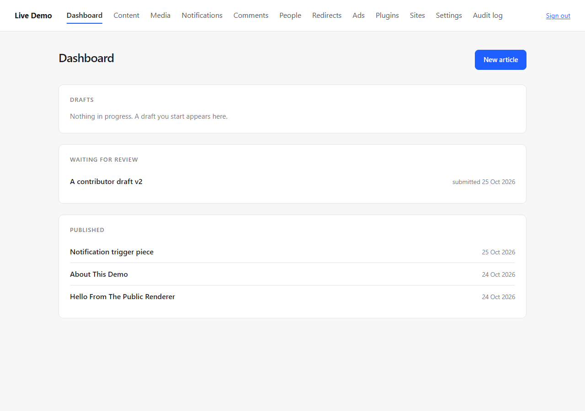
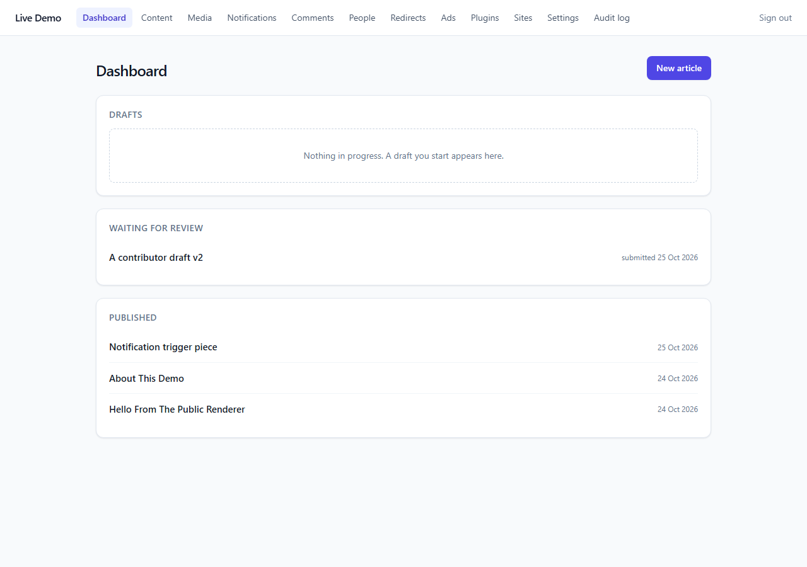
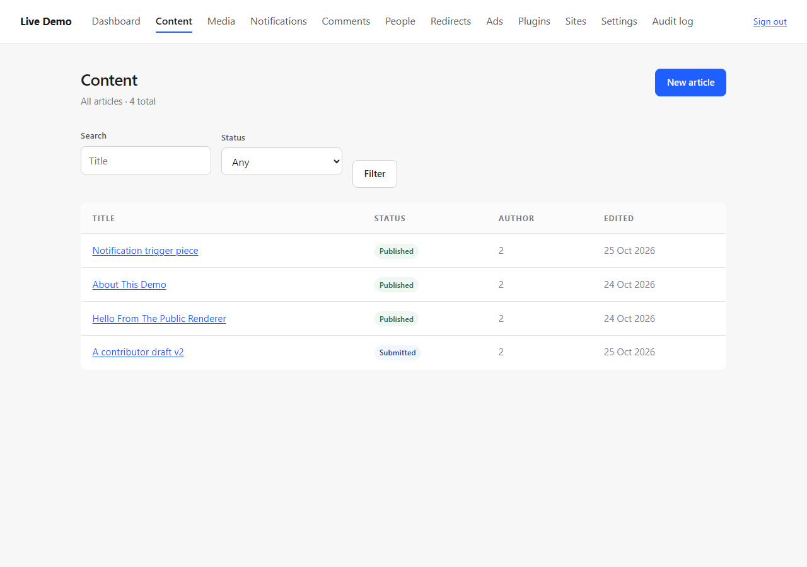
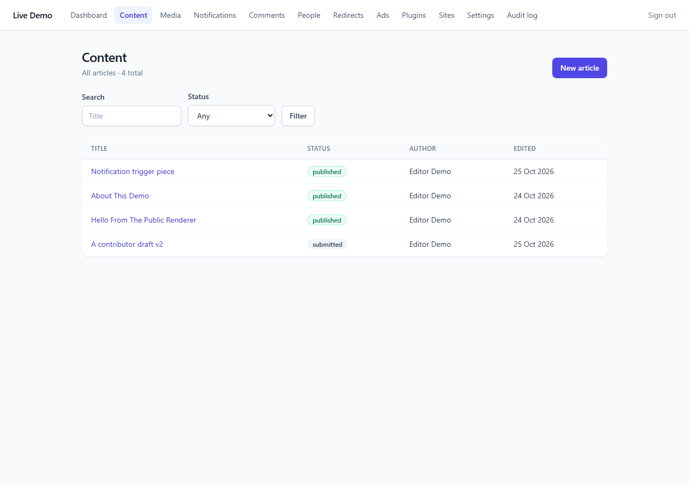
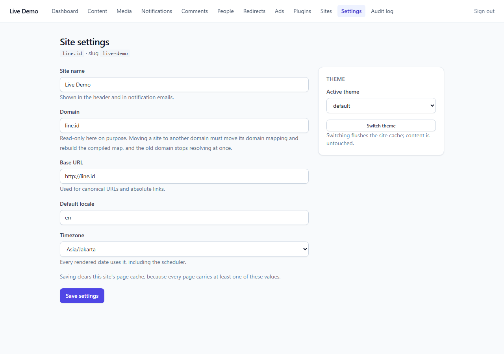

# Admin UI: Tailwind, Without Node in Production

The admin worked and looked like it. The question was whether it could use Tailwind — and the
constraint is that **production must not require Node**. Both can be true at once: Tailwind is a
build-time tool, the resulting CSS is a committed static file, and the runtime never sees `npx`.

---

## How it works

```text
resources/admin.tailwind.css     source: @tailwind layers + the component classes
tailwind.config.js               scans app/Modules/Admin/Resources/views/**/*.php
public/assets/admin.css          BUILD OUTPUT, committed (30 KB minified)

Build:
  npx tailwindcss@3.4.19 -c tailwind.config.js \
      -i resources/admin.tailwind.css -o public/assets/admin.css --minify
```

No `package.json`, no `node_modules`, no CI step. A host runs the committed CSS exactly like the
hand-written one it replaced. The build is repeated only when a view or the design system changes.

**The views did not change.** They use semantic classes (`panel`, `field__input`, `button--primary`,
`badge--published`), and `resources/admin.tailwind.css` implements those classes with `@apply`. That
keeps the markup readable — no utility soup in 12 screens — and puts the visual language in one
reviewable file.

---

## Before / after

| | |
|---|---|
| Dashboard, before |  |
| Dashboard, after |  |
| Content list, before |  |
| Content list, after |  |
| Settings, after |  |

The change is a design system, not a repaint: sticky white topbar with an indigo active pill, cards
with a 1-px border and a soft shadow instead of a flat well, a real table header, status pills
(emerald for published, rose for trashed, amber for waiting), form fields with focus rings, and a
consistent type scale. Every interactive control keeps a visible `:focus-visible` ring.

---

## Two bugs found while doing it

**1. `@apply block` applied the wrong thing — twice over.** `block` is a Tailwind utility *and* a
component class in this file (the content-block card). Inside `@layer components`, `@apply block`
resolved to **my component**, so `.field`, `.field__label` and `.field__input` silently inherited a
white card background, a border and padding. The result: labels rendered as input boxes and inputs
looked like cards. It was caught by looking at the screenshot, not by a test — which is exactly why
the screenshots are in this report.

The fix is `display: block;` next to `@apply`, with a comment at the top of the file so the next
person does not repeat it. `@apply inline` hit the same circular-dependency rule and got the same
treatment.

**2. The content list printed the raw author id.** `Author: 2` was in the table — a real defect that
had survived every earlier review because no test looked at that cell. The controller now passes an
author-name map (one query, not one per row) and the cell reads `Editor Demo`.

---

## What did not change

- **CSP**: `script-src 'self'` stays. Tailwind here is CSS only; there is no CDN script, no inline
  style attribute, no change to the policy.
- **The public theme**: it keeps its own hand-written CSS. The build touches the admin only, so a
  visitor's page weight does not grow by a byte.
- **Accessibility**: the audit still passes — 17 pages, no mechanical violations. Class names and
  structure are untouched; the `<del>`/`<ins>`, `<th scope>`, labels and landmarks are the same.
- **Tests**: the same suite, unchanged. Visual changes are not asserted by tests; the report's
  screenshots are the evidence for those.

---

## Known limitations

1. **The build is manual.** Editing a view or the design system requires re-running the `npx`
   command; there is no watcher and no CI check that the committed CSS matches the source. A
   `--check` step (build to a temp file, diff) would be the honest fix if this becomes a habit.
2. **No dark mode.** The palette is fixed; `dark:` variants are not used.
3. **No icon set.** The admin still uses text labels rather than icons; adding one would be a
   dependency decision, not a styling one.
4. **Tailwind v3, pinned.** Not v4 — v4 changes the CSS-first configuration and would need its own
   review.
5. **Contrast is not measured.** The colours are chosen for it, but the accessibility audit does not
   compute contrast ratios; it remains a human check.
6. **The public site is unchanged**, including its own visual debt.

---

## Files

```text
tailwind.config.js                 NEW  admin-only content scan
resources/admin.tailwind.css       NEW  the design system, ~540 lines of @apply
public/assets/admin.css            REPLACED by the build output (30 KB minified)
app/Modules/Admin/Http/Controller/ContentController.php   author-name map
app/Modules/Admin/Resources/views/content/index.php       author name in the cell
app/Modules/Admin/AdminServiceProvider.php                UserService in the binding
docs/reports/images/admin-*.png    before/after screenshots
```

---

## Ready to merge

yes
