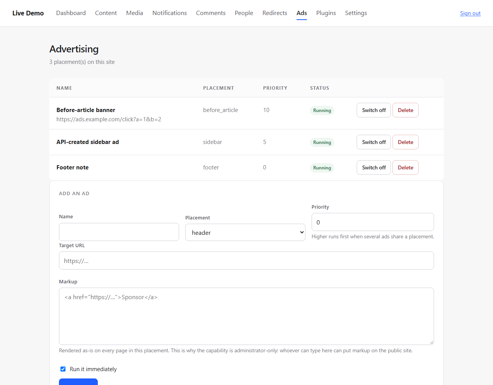

# Advertising Screen, and Why Analytics Has None

`ads.manage` existed in the capability catalogue, the advertising service could create, edit and
delete placements, and the theme printed ad slots — while the only way to add an ad was through the
API. The module with the most complete service had no screen.

That is now closed. The other module in the same position is **not** closed, and the reason is the
interesting part.

---

## Advertising

```text
/admin/ads             every placement, with its state
POST /admin/ads            create
POST /admin/ads/toggle     switch on or off
POST /admin/ads/delete     remove
```

| | |
|---|---|
| capability | `ads.manage` — administrator, not editor |
| cache | every change flushes the site cache, because an ad is on every page in its slot |
| markup | rendered as-is, and the screen says so plainly |

The markup warning is deliberate rather than decorative:

> Rendered as-is on every page in this placement. This is why the capability is administrator-only:
> whoever can type here can put markup on the public site.

An ad is HTML by definition. Pretending otherwise — sanitising it into a `<div>` with a link — would
make the feature unable to do the thing ads do. The honest options are "trust the capability" or
"do not ship ads", and the capability system already answers that.

Validation: a name (so it can be recognised in the list), non-empty markup, and an absolute
`http(s)` target — `javascript:` is refused.

---

## Why there is no analytics screen

`AnalyticsServiceInterface` has two methods:

```php
public function render(int $siteId): string;   // the snippet to inject
public function provider(int $siteId): string; // which provider is configured
```

There are **no statistics**. The module injects a third-party snippet and knows nothing about what
that third party measures. A screen showing page views would have to invent them, which is worse
than no screen: a dashboard full of fabricated numbers is a lie with a progress bar.

What *could* be shown is the provider and the snippet in a read-only box. That is a settings row,
not a screen, and it belongs on the site settings page rather than in the menu. Recorded as a
limitation rather than built as a placeholder.

---

## A finding from the screen's first test

The screen accepts seven placements (`header`, `sidebar`, `before_article`, `middle_article`,
`after_article`, `sticky`, `footer`) and lists all of them honestly.

`themes/default` prints **two**: `before_article` and `after_article`. So five placements can be
created, switched on, listed as *Running* — and never appear anywhere.

The first test asserted the opposite because it assumed `header` rendered; it failed, and the
grep that followed is what surfaced the mismatch. The screen now tells the truth about the data;
the theme tells the truth about its own slots; nothing connects the two.

**That is a real gap and it is not fixed here.** The options are: a per-placement `rendered` flag
derived from the theme manifest, or the theme declaring the slots it provides and the screen listing
only those. Both are design decisions about how themes and modules negotiate, not a one-line fix.

---

## Files

```text
app/Modules/Admin/Http/Controller/AdController.php    NEW
app/Modules/Admin/Resources/views/ads/index.php       NEW
app/Modules/Admin/AdminServiceProvider.php            4 routes, 1 binding
app/Modules/Admin/Resources/views/layout.php          Ads in the nav, capability-filtered
tests/Integration/Modules/Admin/AdminAdTest.php  NEW  10 tests
```

No new CSS: table, badge, panel, field and check styles already existed.

---

## Tests

| | |
|---|---|
| access | an editor is refused (403) |
| create | appears in the list **and on the article page**, with the cache flushed |
| validation | `javascript:` target refused; empty markup refused — nothing stored |
| toggle | switches off and stops rendering |
| delete | removes it |
| unknown id | 404 on toggle and on delete |
| CSRF | an action without a token changes nothing |
| tenant | another site's ads are neither listed nor counted |
| navigation | the Ads entry appears only for someone who can use it |

```text
PHPUnit 11.5.57 - PHP 8.3.6
OK (1374 tests, 4326 assertions)
```

---

## Verified by looking



Three placements with state, and the create form whose markup field carries the warning that makes
the capability choice legible.

---

## Known limitations

1. **Five of seven placements render nowhere** — see the finding above.
2. **No date window in the screen.** `Ad::startsAt` / `endsAt` exist and the service honours them;
   the form does not offer them.
3. **No rule targeting.** `rules` (content type, taxonomy) exist in the entity and the service; the
   screen does not edit them.
4. **No duplication.** Cloning an ad means typing it again.
5. **No preview.** The markup is rendered on save, not shown in the form.
6. **No analytics screen, by design** — the module has no statistics to show.
7. **A created ad flushes the whole site cache.** Targeted invalidation would need an ad dependency
   in the page cache; a placement touches every page, so the blunt flush is at least honest.

---

## CONTRACT_CHANGE_REQUEST

none

---

## Ready to merge

yes
