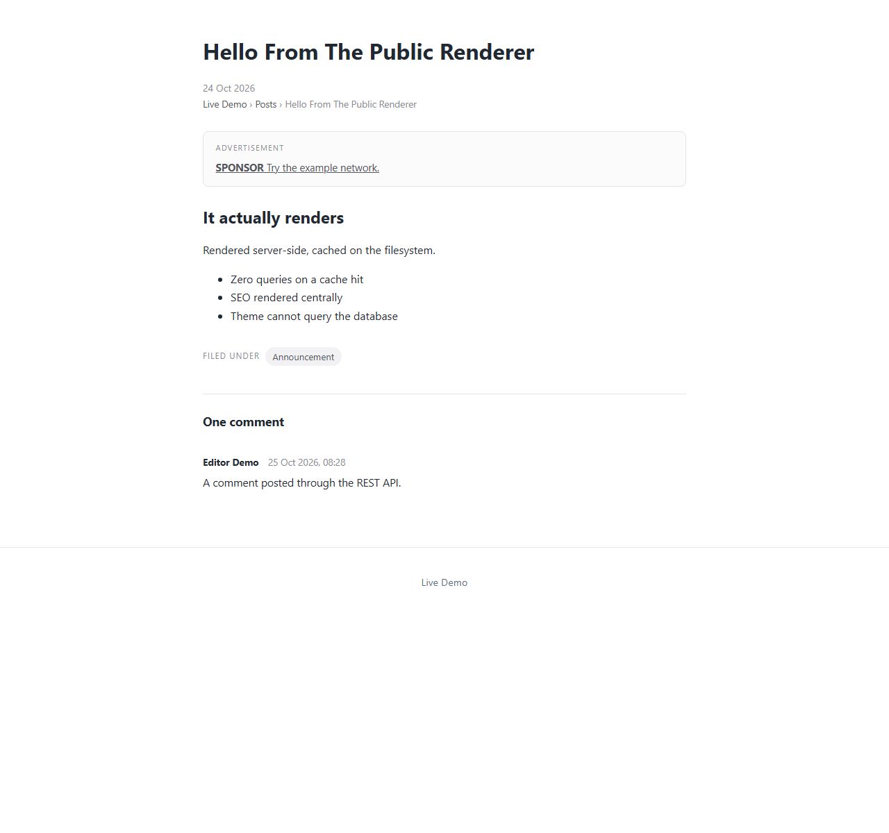
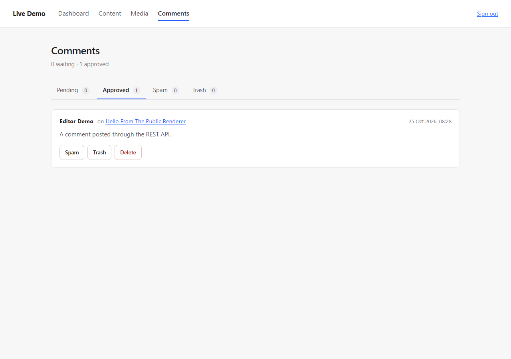

# Comments: Display and Moderation

An approved comment sat in the database for weeks while the article page rendered nothing. The
comment module had a service, an API, moderation capabilities and a passing test suite; a reader
had never seen a single comment.

This closes the display and moderation half, and reports the half that is blocked on a decision.

---

## What now works

```
public article page      approved comments, with author, date and body
/admin/comments          moderation queue: pending, approved, spam, trash
```

- Only **approved** comments reach a reader. Pending, spam and trashed comments never do, and a
  test pins each of those.
- An article with no comments and closed comments renders **no section at all** — an empty heading
  is noise. An open article with none says "No comments yet."
- The count reads naturally: *One comment*, *2 comments*.
- Comment bodies are escaped and their line breaks preserved.
- The moderation screen offers Approve / Spam / Trash / Delete, each a POST that redirects back to
  the same filter, so a refresh cannot repeat it and moderating a queue is a series of clicks.
- The queue names the **article**, not its id, resolving titles through the content service (one
  memoised lookup per article).
- The *Comments* menu entry appears only for someone holding `comment.moderate`; a menu item that
  leads to a 403 page is worse than no menu item.





---

## What is blocked, and why

**A visitor cannot post a comment.** This is not a wiring gap; it is the schema and the absence of
a reader identity:

```sql
comments.user_id BIGINT UNSIGNED NOT NULL
```

`author_name` is denormalised from that user at submission, and the only sign-in this platform
offers is `/admin/login`, which is staff. So the set of people who can comment today is "staff",
and the API requires authentication to post.

Reaching a public comment form needs a deliberate decision, because each route has consequences:

| Option | Needs | Cost / risk |
|---|---|---|
| **A. Anonymous comments** | migration making `user_id` nullable, an `author_name` field on the form, a `submit()` signature that accepts a name instead of a user | spam becomes the operator's problem; names are personal data; the API contract changes |
| **B. Reader accounts** | public registration, reader login, email verification, password reset for readers | much larger; a second identity system with its own security surface |
| **C. Keep it staff-only** | nothing | comments stay an internal note feature; the public section shows whatever staff post |

**My recommendation is A**, with the moderation queue that already exists doing the work:

- `user_id` becomes nullable, `author_name` is already stored, and the comment still starts
  `pending`, so nothing reaches a reader unapproved;
- a honeypot field plus the existing rate limiter make casual spam unprofitable;
- no email address is collected, which keeps the personal data to a display name the commenter
  chose to type.

That is a schema migration and a service signature change, so it wants an explicit yes rather than
my judgement inside a "continue".

I did **not** build a form that would fail with a 401, and I did not fake the feature in the
interface. The page shows what exists; the gap is written down here and in `HANDOVER.md`.

---

## Files

```text
app/Modules/Theme/Rendering/PageViewModelFactory.php   commentThread(), comments + comments_open
app/Modules/Theme/ThemeServiceProvider.php             passes CommentServiceInterface (optional)
themes/default/partials/comments.php             NEW   the display partial
themes/default/templates/single.php                    includes it after the article
themes/default/assets/theme.css                        comment styles
app/Modules/Admin/Http/Controller/CommentController.php   NEW  queue + 4 actions
app/Modules/Admin/Resources/views/comments/index.php      NEW
app/Modules/Admin/AdminServiceProvider.php               5 routes, 1 binding
app/Modules/Admin/Resources/views/layout.php             capability-filtered nav entry
public/assets/admin.css                                  tabs and comment cards
tests/Integration/Modules/Theme/PublicCommentTest.php     NEW, 7 tests
tests/Integration/Modules/Admin/AdminCommentTest.php      NEW, 9 tests
```

---

## Tests

| Public display | |
|---|---|
| approved shown | author, date, body and "One comment" all present |
| pending hidden | never rendered, even though the row exists |
| spam hidden | |
| empty + closed | no section at all |
| empty + open | the section says there are none |
| counting | "One comment" vs "2 comments" |
| escaping | a `<script>` body is escaped |

| Moderation | |
|---|---|
| capability | a contributor gets 403; an editor sees the queue |
| queue content | names the article, shows the body and the actions |
| nav | the Comments entry appears only for someone who can use it |
| approve | moves to approved **and the comment becomes visible on the article page** |
| spam / trash | move the comment out of the queue |
| CSRF | an action without a token is refused and changes nothing |
| cross-tenant | a comment from another site is a 404 on both approve and delete |
| filters | pending and approved lists do not show each other's items |
| bad status | an unknown `?status=` falls back to pending |

```text
PHPUnit 11.5.57 - PHP 8.3.6
OK (1270 tests, 3993 assertions)
```

---

## Known limitations

1. **No public posting** — see above. This is the one that matters.
2. **No reply form.** Threading is supported by the service (`parent_id`, `depth`) and rendered
   with indentation, but nothing can create a reply except the API.
3. **No edit.** A moderator can approve, mark spam, trash or delete, not fix a typo.
4. **No pagination.** The queue shows 50 per status.
5. **No bulk actions.** One comment at a time.
6. **Article `comment_status` cannot be changed from the editor.** It defaults to open in the
   database, and the only way to close comments on an article is SQL.
7. **No spam heuristics.** Marking spam is manual, and nothing learns from it.

Limitation 6 is worth fixing early: "close comments on this old article" is a routine editorial
task and currently needs a database client.

---

## CONTRACT_CHANGE_REQUEST

none

No contract changed. `PageViewModelFactory` gained one optional constructor parameter at the end,
following the pattern already used for advertising and analytics.

---

## Ready to merge

yes
