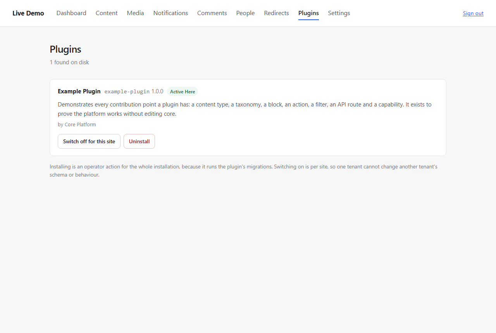

# Plugins Screen

The plugin platform was the most thoroughly built part of the project: discovery, manifests,
lifecycle, per-site activation, hook registry, migrations, a capability registry, and an example
plugin that registers a content type, taxonomy, block, action, filter, API route and capability.
All of it was reachable only from code.

`/admin/plugins` puts the switch where an operator can reach it.

---

## The three states, kept apart

The screen exists because these are easy to conflate, and conflating them is how one tenant's
experiment changes another tenant's schema:

| State | Meaning | Scope |
|---|---|---|
| **discovered** | the directory exists and its manifest parses | platform |
| **installed** | registered, migrations have run | **whole installation** |
| **active** | switched on | **this site only** |

Installing is an operator action because it runs migrations. Activation is a per-tenant switch.
A test asserts exactly that: after activating on site A, `isActiveFor(site B)` is still false.

---

## What the screen does

```text
/admin/plugins              every plugin found on disk, with its state
POST /admin/plugins/install      register it, run migrations
POST /admin/plugins/uninstall    remove the registration and its capabilities
POST /admin/plugins/activate     switch on for this site
POST /admin/plugins/deactivate   switch off for this site, stays installed
```

Each plugin shows its title, name and version, description, author, and the plugins it requires —
all read from the manifest, so a new plugin appears with no code change here.

Authorization is `plugins.manage`, which belongs to the administrator. An editor gets 403: the
screen can run migrations, which is not an editorial act.

Behaviours worth stating:

- **Activating before installing** is explained as a message, not thrown: "Install it before
  switching it on."
- **Uninstall does not delete data.** It removes the registration, its site activations and its
  capabilities; tables the plugin created stay in the database. The flash message says so, because
  an operator who expects the opposite will be surprised later.
- **An unknown plugin name is a 404**, not a 500 from a missing manifest.
- Switching off leaves it installed — the two actions are separate buttons and separate messages.

---

## Files

```text
app/Modules/Admin/Http/Controller/PluginController.php   NEW
app/Modules/Admin/Resources/views/plugins/index.php      NEW
app/Modules/Admin/AdminServiceProvider.php               5 routes, 1 binding
app/Modules/Admin/Resources/views/layout.php             Plugins in the nav, capability-filtered
public/assets/admin.css                                  plugin cards
tests/Integration/Modules/Admin/AdminPluginTest.php    NEW  11 tests
```

The navigation now has nine entries for an administrator: Dashboard, Content, Media, Notifications,
Comments, People, Redirects, Plugins, Settings. Still readable at desktop width; a narrower screen
wraps it rather than hiding anything.

---

## Tests

| | |
|---|---|
| access | an editor is refused (403); `plugins.manage` is administrator-only |
| discovery | the example plugin is listed, with "Not installed" |
| install | registers it and **does not switch it on for anyone** |
| activation | per site: on for this one, off for another |
| deactivation | switched off, still installed |
| activate-before-install | a message, not an exception |
| uninstall | removes the registration |
| unknown plugin | 404 on install and on activate |
| CSRF | every action requires a token |
| screen state | the badges and buttons reflect installed/active |
| navigation | the Plugins entry appears only for someone who can use it |

```text
PHPUnit 11.5.57 - PHP 8.3.6
OK (1337 tests, 4190 assertions)
```

---

## Verified by looking



The example plugin, active on this site, with *Switch off for this site* and *Uninstall*, and the
note explaining why installing and switching on are different actions.

---

## Known limitations

1. **No upload or install from a zip.** A plugin arrives by putting a directory on disk; that is
   deliberate, and it is also why nothing validates a downloaded package.
2. **No update path.** `install()` runs migrations; a plugin whose version changed is not upgraded
   and there is no version comparison on this screen.
3. **No plugin settings.** A plugin's configuration is its own concern and none of the bundled ones
   has any.
4. **Requirements are displayed, not enforced** (`requires` / `requires_plugins`): activating a
   plugin whose dependency is missing is left to the plugin to fail on.
5. **Uninstall leaves tables behind**, which is stated on screen but means reinstalling does not
   recreate them and a stale table can outlive its plugin.
6. **No uninstall preview** — nothing lists what would be removed before it is.

---

## CONTRACT_CHANGE_REQUEST

none

`PluginManagerInterface` already had everything this screen needs; nothing in the Plugin module
changed.

---

## Ready to merge

yes
