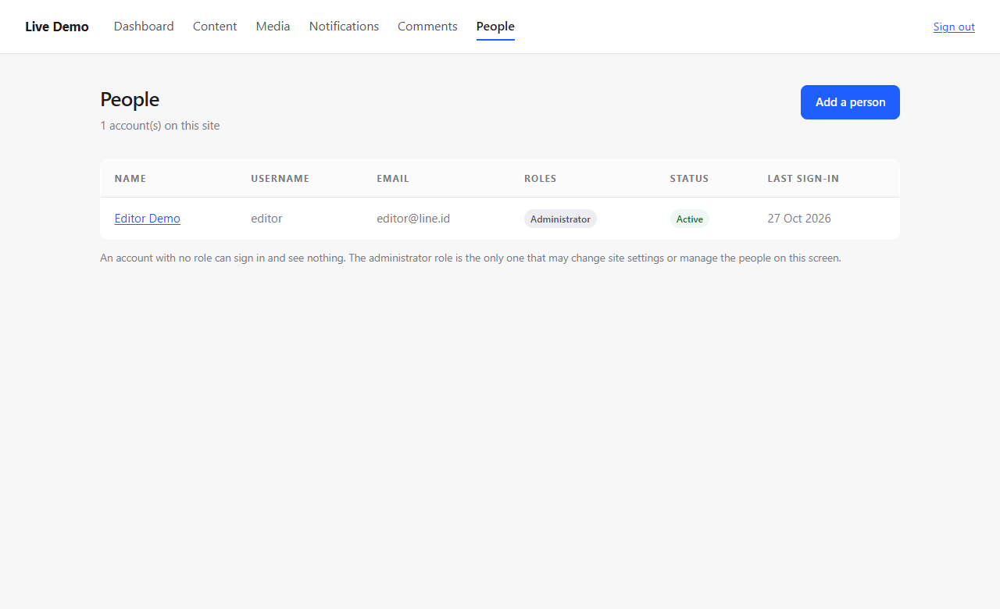

# People and Roles

Adding an editor meant a CLI snippet or direct SQL. Every service involved already existed —
`UserService`, `RoleService`, `assignRole`, `revokeRole` — and none of it was reachable from the
interface. That is the same shape as the analytics snippet, the featured image, and the comment
thread: the contract exists, the consumer does not.

---

## What exists now

```text
/admin/users            who can sign in to this site, with their roles
/admin/users/new        add somebody
/admin/users/{id}       change name, email, status, roles; delete
```

Authorization follows the capability catalogue rather than a new rule:

| Action | Capability | Who holds it |
|---|---|---|
| see the list | `users.read` | administrator, editor |
| add somebody | `users.create` | administrator |
| change somebody | `users.update` | administrator |
| change roles | `roles.assign` | administrator |
| delete | `users.delete` | administrator |

An editor may therefore read the list and cannot add, edit or delete anyone — which is what the
catalogue already said before there was a screen to enforce it.

---

## The four lockout guards

A CMS whose only administrator can lock themselves out needs a database client to recover, which
is precisely what this screen exists to remove. So:

1. **You cannot disable your own account.** Disabling yourself would end the session you are using.
2. **You cannot remove your own administrator role.** The quiet version of the same mistake.
3. **You cannot delete yourself.**
4. **The last administrator cannot be deleted.** The guard counts the accounts holding
   `settings.update` rather than the accounts holding the role by name, so it stays correct if the
   role matrix changes.

Each is a test. The refusal is a form error (409) with the reason, not a silent no-op.

Roles are applied as a **set**: submitted roles are assigned, and roles no longer submitted are
revoked. "Add the new one and forget the old one" is how somebody ends up an administrator by
accident.

---

## Files

```text
app/Modules/Admin/Http/Controller/UserController.php    NEW
app/Modules/Admin/Resources/views/users/index.php       NEW
app/Modules/Admin/Resources/views/users/form.php        NEW
app/Modules/Admin/AdminServiceProvider.php              6 routes, 1 binding
app/Modules/Admin/Resources/views/layout.php            People in the nav, capability-filtered
tests/Integration/Modules/Admin/AdminUserTest.php      NEW  13 tests
```

No new CSS: the table, badge, field and editor styles were already there.

---

## Tests

| | |
|---|---|
| access | a contributor gets 403 on the list; an editor reads it but cannot add |
| create | an administrator adds a person who then **signs in through the real login form** |
| validation | a duplicate username is a 409 form error; a short password is refused by `PasswordPolicy` and nothing is created |
| edit | display name and status change and persist |
| roles | a role set replaces the old one rather than adding to it |
| guards | cannot disable self, cannot drop own administrator role, cannot delete self, last administrator cannot be deleted |
| tenant | a user from another site is a 404 on read and on delete, and survives |
| navigation | the People entry appears only for someone who can use it |

```text
PHPUnit 11.5.57 - PHP 8.3.6
OK (1305 tests, 4108 assertions)
```

---

## Verified by looking



Table of accounts with role badges and status, the add button, and the note about what an account
with no role can do.

---

## Deferred: site settings

The other half of this task — a screen for name, domain, locale, timezone and base URL — needs a
module change first:

```text
SiteServiceInterface has: findById, findBySlug, all, addDomain, removeDomain, regenerateDomainMap
It has no update().
```

Writing the row from the admin controller would mean reaching into the Site module's repository,
which is exactly the boundary violation the module split exists to prevent. The honest order is:
add `SiteService::update()` with a repository method behind it, regenerate the domain map when the
domain changes, then build the screen. That is a small, separate change and is not in this commit.

Changing the primary domain also has a consequence worth deciding deliberately: the *old* domain
stops resolving immediately, so a site can be locked out of its own admin by a typo. A screen for it
should probably not offer the domain field until that is thought through.

---

## Known limitations

1. **No password reset from this screen.** An administrator can create an account but not issue a
   reset; the person uses the forgot-password flow, which needs working mail.
2. **No invitation email.** The password is typed by the administrator and passed on by hand.
3. **No pagination.** Every account on the site is listed on one page.
4. **Roles are fetched per user** — one query each, which is fine for a small editorial team and
   would not be for ten thousand accounts.
5. **No audit trail.** Nothing records who changed whose roles.
6. **Email is not verified**, and nothing prevents two accounts on different sites sharing an email.
7. **No per-user notification preferences.** The switches are per site, by design.

---

## CONTRACT_CHANGE_REQUEST

none

---

## Ready to merge

yes
