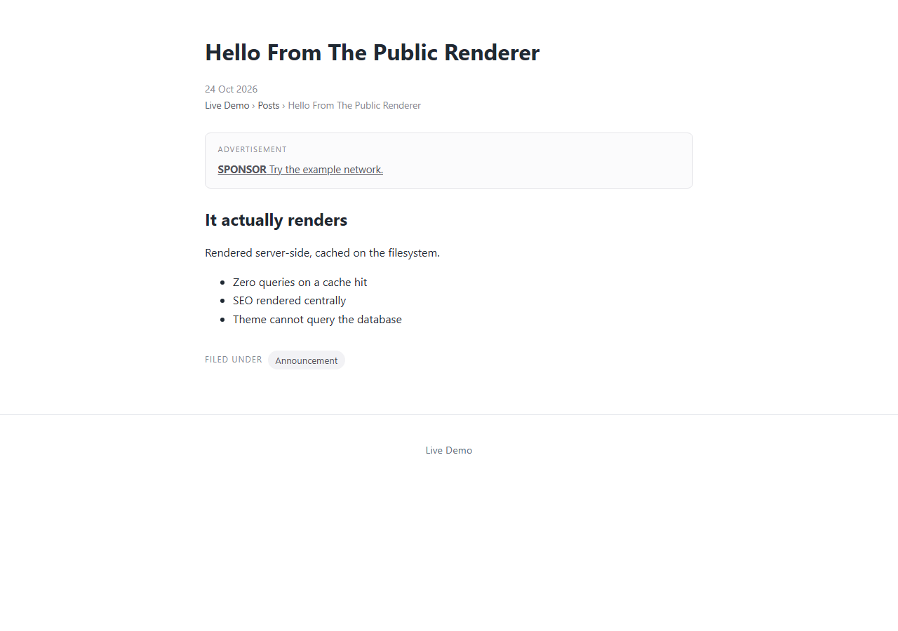
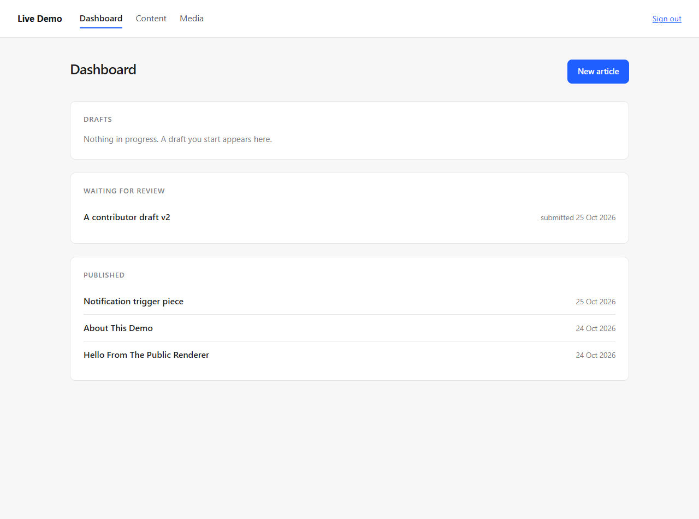
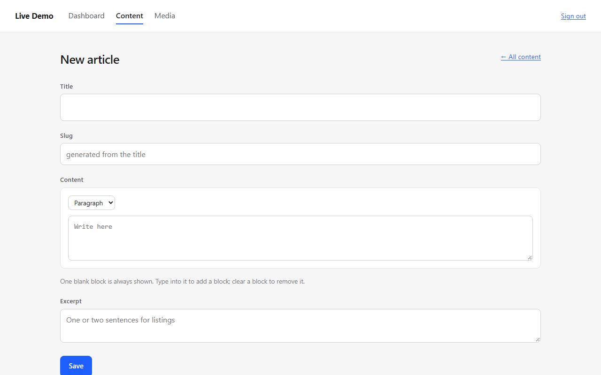
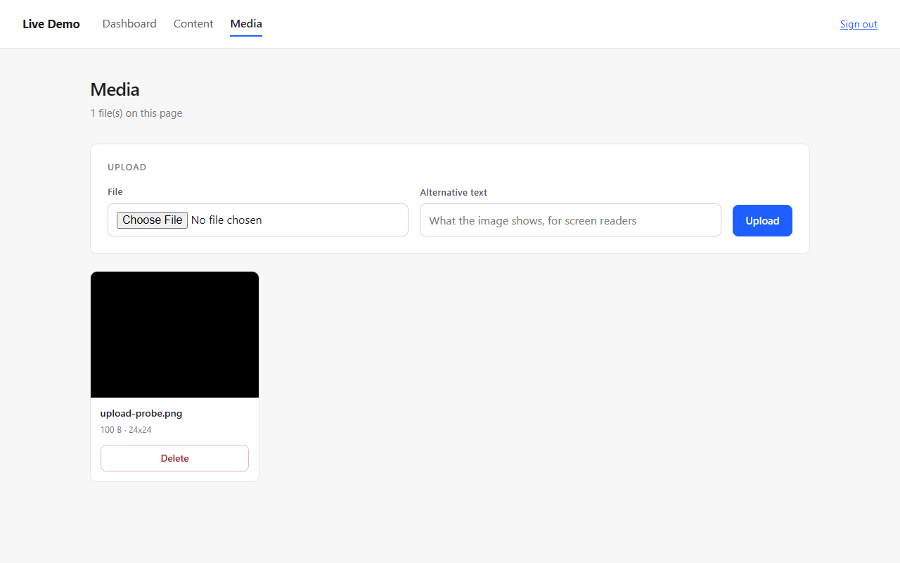
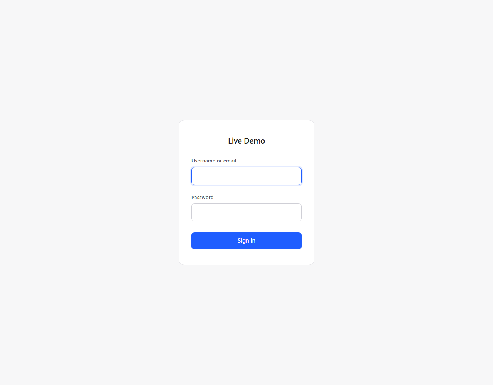

# Visual Verification

The project had 1246 passing tests and nobody had ever looked at it. Tests check markup, status
codes and headers; they cannot see that a page is unstyled, that a date is printed as
`2026-10-24T12:21:47+00:00` to a reader, or that half the screen is empty.

This is the first time the interface was rendered and looked at. Chrome headless, real CSS from
the running server, screenshots read back and inspected.

**The first screenshot found that the public site had never been styled at all.**

---

## The defect

```text
themes/default/partials/head.php
  <link rel="stylesheet" href="/themes/default/assets/theme.css">

GET /themes/default/assets/theme.css   404
```

`themes/` sits outside the document root. That is deliberate — a theme must not be able to run
PHP or read `.env` — but it means the web server cannot find the file, so something else has to
hand it out. Nothing did. Every public page rendered as unstyled Times New Roman with blue
underlined links, and no test noticed because no test renders.

```
before                                    after
─────────────────────────────────────     ─────────────────────────────────────
Times New Roman, 1280px wide,             constrained column, system font,
no layout, no spacing                     breadcrumbs, labelled ad slot,
                                          "FILED UNDER" chip, footer
```

## The fix

A route, registered **before** the public catch-all:

```text
GET /themes/{theme:[A-Za-z0-9_-]+}/assets/{file:[A-Za-z0-9._-]+}
```

`ThemeAssetController` serves it with four deliberate constraints:

| Constraint | Why |
|---|---|
| only installed themes (`ThemeRegistry::has`) | so the route cannot read an arbitrary directory |
| file name matched by the route pattern | no separators, no `..` — checked again in the controller |
| extension allow-list (`css`, `js`, `svg`, `png`, `woff2`, …) | a stray `.php` is never handed out, whatever is in the directory |
| content type from the extension, never sniffed | plus `nosniff` |

`head.php` also stopped hardcoding the path. The view model had been passing `theme_assets` all
along and the template ignored it — the same shape of gap as the analytics snippet and the
featured image. It now uses that value with a version query derived from the file's modification
time, so a theme edit is visible immediately instead of after the hour-long cache.

---

## What looking at it found, beyond the stylesheet

Four things no test would have caught. All fixed.

| Found | Fix |
|---|---|
| **The published date printed as raw ISO** — `2026-10-24T12:21:47+00:00` — in front of the reader | the view model now passes `published_display` (`24 Oct 2026`) for the text and keeps `published_at` for the `datetime` attribute |
| **Ad slots had a wrapper but no styling**, so a sponsored line sat in the article text like a stray link | `.ad-slot` is a quiet bordered block with an *Advertisement* label |
| **A category rendered as a bare bullet** under the article, with nothing saying what it was | `.terms` is a labelled chip list: *Filed under · Announcement* |
| **The new-article editor reserved an empty 20rem sidebar**, leaving half the screen blank | `.editor--single` collapses the grid when there are no panels to show |

Two smaller ones: the media library printed `0 KB` for a 100-byte file (now `100 B`), and a
`\n` escape had been written literally into the editor template by my own tooling, which would
have appeared as text on the page. Caught by grep for `\\n<` in the views.

---

## The screens

Rendered from the running site, with the real stylesheet.

### The article page



### The dashboard



### A new article



### The media library



### Sign-in



---

## Tests added

`tests/Integration/Modules/Theme/ThemeAssetRouteTest.php` — 8 tests, 19 assertions:

- the stylesheet is served as `text/css` with real content
- assets are cacheable, `nosniff`, and carry `Last-Modified`
- **the page links a stylesheet URL that actually resolves** — the regression itself: fetch the
  page, extract the `href` it emits, request it, expect 200
- the version query is present and derived from the file
- an unknown theme is 404, a `.php` in assets is 404, a missing file is 404, traversal is refused

The third one is the test that would have prevented this: it does not assert that a link exists,
it asserts that following the link works.

```text
PHPUnit 11.5.57 - PHP 8.3.6
OK (1254 tests, 3948 assertions)
```

---

## What this says about the project

The suite is good at what it was pointed at and blind to what it was not. Every test verified
that the right bytes came back; none verified that the bytes were worth looking at. That is not a
gap you close with more assertions of the same kind — it needs someone to open the page.

It also says something about the earlier reports in this repository: they claimed the public site
was "verified end to end". It was verified *served*, not *visible*. That distinction should have
been stated, and was not.

---

## Known limitations

1. **Screenshots are not an accessibility audit.** Colour contrast, focus order and screen-reader
   behaviour are still unverified.
2. **One viewport tested** (1280px). The CSS has a `56rem` breakpoint that was never rendered at a
   phone width.
3. **Chrome only.** No Safari, Firefox or older-browser check.
4. **Admin screens were rendered from saved HTML with a `<base>` tag**, not through a live
   authenticated browser session. Layout and CSS are faithful; JavaScript behaviour is not
   exercised there (there is none in the admin anyway).
5. **The default theme is deliberately plain.** It is a usable starting point, not a design.

---

## CONTRACT_CHANGE_REQUEST

none

---

## Ready to merge

yes
